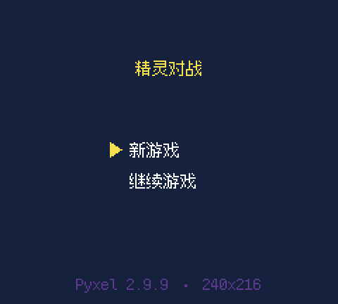
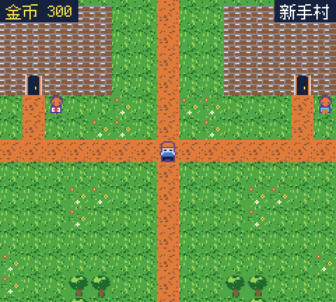
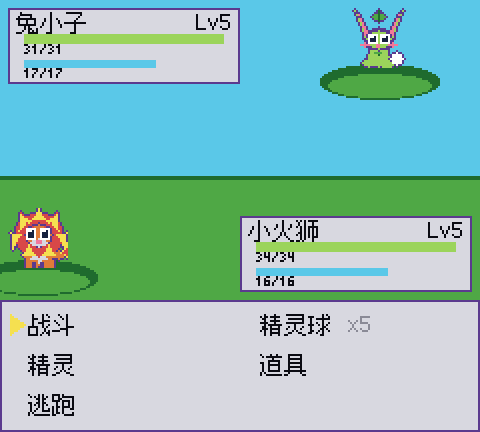
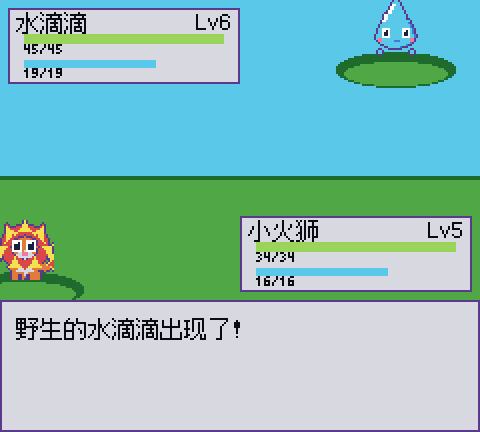
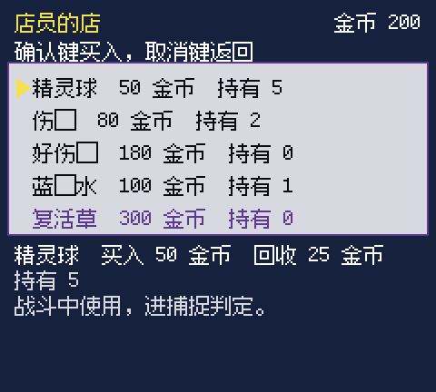
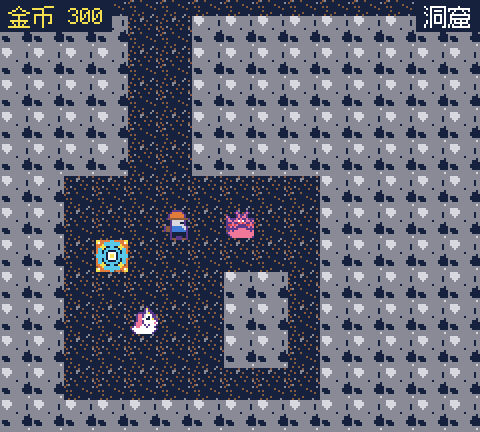

# 精灵对战小游戏

> 一款像素卡通风格的 2D 俯视角精灵对战 RPG，用 Python + [Pyxel](https://github.com/kitao/pyxel) 写的，源码全部公开。
>
> 玩法循环：**探索地图 → 遭遇野生精灵 → 战斗 / 捕捉 → 治疗与养成 → 商店补给 → 继续探索**

## 平台支持

**Windows / macOS / Linux 都能跑**——纯 Python + Pyxel，不需要显卡、不需要联网。

中文渲染用**随仓库分发的开源点阵字体** Ark Pixel Font 12px（OFL 1.1，见
`assets/fonts/OFL.txt`），**不依赖操作系统字体**。早先版本依赖 Windows 系统黑体、
只能在 Windows 上运行，这个问题已经解决。

逻辑层与引擎层是分开的，测试全部用标准库 `unittest`，`pip install pyxel` 即可开跑。

## 快速开始（2 分钟）

```bash
git clone https://github.com/ssda56/pyxel-creature-battle.git
cd pyxel-creature-battle
pip install -r requirements.txt
python main.py
```

- 需要 **Windows** 和 **Python 3**（作者环境为 3.12.14）。
- 依赖只有 `pyxel==2.9.9` 一个（见 `requirements.txt`），其余全是标准库。
- 启动后进入标题画面：`Z` 确认，方向键 / `WASD` 移动。
- **游玩前请把输入法切成英文**，否则人物不动（Windows + SDL 的行为，见 §8.1）。
- 操作、界面、存档的完整说明见 **[docs/游戏说明书.md](docs/游戏说明书.md)**。

## 截图

| 标题画面 | 村庄 | 回合制战斗指令 |
|---|---|---|
|  |  |  |

| 野外遭遇战 | 商店购买 | 洞穴 |
|---|---|---|
|  |  |  |

## 项目概览

| 项 | 值 |
|---|---|
| 画面 | 240 × 216，60 fps，自定义 16 色调色板 |
| 引擎 | Pyxel 2.9.9 / Python 3.12.14 |
| 内容规模 | 18 只精灵 · 35 个技能 · 3 张地图 · 5 件道具 · 15 个音效 · 3 段 BGM |
| 自动化测试 | 584 个用例，全绿（标准库 `unittest`） |
| 状态 | **功能完整，可从头玩到尾** |

> **玩家向的说明**（怎么操作、界面怎么读、怎么存档）在 **[docs/游戏说明书.md](docs/游戏说明书.md)**。
> 本文档面向开发者与维护者。
>
> 里程碑 M0–M8 的逐条核对结论在 **[docs/里程碑核对.md](docs/里程碑核对.md)**。
> 动工前的规划稿（与实际实现有出入，逐条见 §7）在 **[docs/01-规划开发文档.md](docs/01-规划开发文档.md)**。

---

## 1. 环境

| 项 | 值 |
|---|---|
| 解释器 | Python 3.12.14（作者的开发环境版本） |
| 依赖 | 仅 `pyxel` 2.9.9 + Python 标准库，见 [`requirements.txt`](requirements.txt) |
| 画面 | 240 × 216，60 fps（已锁定） |
| 操作系统 | **Windows / macOS / Linux 均可**（中文用随仓库分发的 OFL 点阵字体，不依赖系统字体） |

> 依赖只有一个包：`pyxel`。除此之外不需要任何第三方库，
> `pip install -r requirements.txt` 之后就够用了。

## 2. 运行

在仓库根目录：

```bash
python main.py
```

> Windows 用户如果习惯用虚拟环境，可以先建一个再运行（仓库里的 `.venv/` 已被 `.gitignore` 忽略）：
>
> ```powershell
> python -m venv .venv
> .\.venv\Scripts\python.exe main.py
> ```

无窗口自检（不依赖显示器，用于 CI / 截图核对）：

```bash
python main.py --headless --frames 10 --shot docs/shots/_check.png
```

> `docs/shots/_*.png` 已在 `.gitignore` 里，自检截图不会进版本库。

## 3. 操作

| 动作 | 按键 |
|---|---|
| 移动 | **W A S D** 或 方向键（两种都支持） |
| 确认 | Z / K / Enter |
| 取消 | X / J / Backspace |
| 打开菜单 | C |
| 退出确认弹窗 | Esc（不再直接退出，见下） |
| 静音开关 | M |

**Esc 的行为**：`main.py` 给 `pyxel.init` 传了 `quit_key=pyxel.KEY_NONE`，关掉了 Pyxel 自带的
"Esc 立刻退出"。Esc 改由 `src/core/game.py` 接管，弹出**退出确认弹窗**
（存档并退出 / 直接退出 / 取消），弹窗期间游戏逻辑暂停。

**游玩前请把输入法切成英文**，否则人物不动 —— 这是 Windows + SDL 的行为，不是 bug，详见 §8.1。

## 4. 跑测试

用标准库 `unittest`（**不是 pytest**，环境里没装，也别装）：

```bash
python -m unittest discover -s tests -t .
```

> Windows 用户用虚拟环境时：`.\.venv\Scripts\python.exe -m unittest discover -s tests -t .`

### ⚠️ PowerShell 下的假失败

`unittest` 把进度点写到 **stderr**，PowerShell 会把它当成 `NativeCommandError`，
于是**即使全部通过，`$LASTEXITCODE` 也是 1**。看结论请认准这两行，别看退出码：

```
Ran 584 tests in 5.447s
OK
```

想拿到干净的退出码，把 stderr 合进 stdout：

```powershell
python -m unittest discover -s tests -t . 2>&1 | Select-Object -Last 5
```

## 5. 目录结构

```
pyxel-creature-battle/
├── main.py                          # 入口：pyxel.init / run，场景调度
├── README.md                        # 本文档（开发者向）
├── LICENSE                          # MIT 协议全文
├── NOTICE                           # 第三方资源署名（Pyxel / 示例音频 / 字体说明）
├── requirements.txt                 # 运行依赖：pyxel==2.9.9
├── assets/
│   ├── audio/                       # 2 段 BGM（Pyxel 官方示例音频，MIT，见 NOTICE）
│   │   ├── README.md                # 这两个 ogg 的来源说明
│   │   ├── bgm1.ogg
│   │   └── bgm2.ogg
│   └── fonts/
│       ├── ark-pixel-12px-monospaced-zh_hans.ttf   # 随仓库分发的 OFL 点阵字体
│       ├── OFL.txt                  # 该字体的授权全文
│       └── README.md                # 字体说明（见 §6.1）
├── docs/
│   ├── 游戏说明书.md                 # 玩家向操作说明
│   ├── 数值设定.md                   # 全部数值的唯一权威来源
│   ├── 里程碑核对.md                 # M0–M8 逐条核对结论
│   ├── 01-规划开发文档.md            # 动工前的规划稿（未同步，见 §7）
│   ├── 美术生图提示词.md             # AI 生图提示词（最终未采用，见 §8.3）
│   └── shots/                       # 各批次截图归档
├── saves/                           # 存档目录（save1.json 已被 .gitignore 忽略）
├── tools/
│   └── art_import.py                # 可选：AI 图 → 字符画转换器（需 Pillow，未参与构建）
├── src/
│   ├── core/
│   │   ├── game.py                  # App 主类：update/draw 分发、退出确认弹窗、静音提示
│   │   ├── scene_manager.py         # 场景栈（push / pop / replace）
│   │   ├── input.py                 # 输入抽象（9 动作，RealInput / FakeInput）
│   │   └── focus.py                 # 启动时把窗口抢到前台（Windows）
│   ├── data/                        # 纯数据层，不含逻辑
│   │   ├── species_data.py          # 18 只精灵种族表
│   │   ├── skill_data.py            # 35 个技能
│   │   ├── item_data.py             # 5 件道具 + 初始背包 + 初始金币
│   │   └── map_data.py              # 3 张地图、走行性、传送点、刷怪点、NPC、遇敌表
│   ├── model/                       # 纯模型层，不 import 任何 UI / 引擎模块
│   │   ├── creature.py              # 精灵实例：等级 / 经验 / HP / MP / 技能
│   │   ├── player.py                # 玩家：金币 / 队伍 / 仓库 / 背包
│   │   └── save_io.py               # 存档读写（原子写入、读档不抛异常）
│   ├── battle/                      # 纯计算层
│   │   ├── type_chart.py            # 8×8 属性克制表（7 正式属性 + 内部"无"）
│   │   ├── damage_calc.py           # 伤害公式
│   │   └── catch_calc.py            # 捕捉概率公式
│   ├── scenes/
│   │   ├── scene_base.py            # enter / resume / exit / update / draw
│   │   ├── title_scene.py           # 标题：新游戏 / 继续游戏
│   │   ├── starter_scene.py         # 开局三选一
│   │   ├── field_scene.py           # 地图探索：移动 / 碰撞 / 摄像机 / 明雷 / NPC / 传送
│   │   ├── battle_scene.py          # 回合制战斗（五指令）
│   │   ├── menu_scene.py            # 主菜单：精灵 / 道具 / 存档 / 返回
│   │   └── shop_scene.py            # 商店买卖
│   ├── ui/
│   │   ├── text.py                  # 中文渲染（字体路径只在这个文件里）
│   │   ├── widgets.py               # 列表 / 对话框 / 血条蓝条
│   │   ├── damage_number.py         # 圆圈数字伤害飘字
│   │   ├── transition.py            # Bayer 抖动淡入淡出
│   │   └── sound.py                 # 音效与 BGM（15 SFX / 3 BGM / 静音）
│   └── assets_gen/                  # 程序化素材（规划文档的"方案 D"）
│       ├── palette.py               # 全局唯一配色来源 + 属性→主色表
│       ├── sprite_base.py           # 字符画烘焙器 + 绘图画布
│       └── sprites/
│           ├── tileset.py           # 12 种 16×16 图块
│           ├── player.py            # 主角 4 方向 × 2 帧
│           └── creatures.py         # 18 只精灵（战斗图 32×32 + 图标 16×16）
└── tests/                           # 584 个用例
    ├── helpers.py                   # 无窗口跑帧 / 截图 / 假输入
    ├── field_helpers.py             # FieldScene 专用辅助
    ├── battle_helpers.py            # BattleScene 专用辅助
    └── test_*.py                    # 45 个测试文件，按模块划分
```

## 6. 关键约定（改代码前必读）

### 6.1 中文字体

- **字体路径只允许出现在 `src/ui/text.py`**，其他任何文件都不许写字体路径。
- **所有中文必须经 `src/ui/text.py` 渲染**，禁止直接用 `pyxel.text` 画中文。

```python
from src.ui import text
text.draw(x, y, "精灵对战", 10)          # 左上角对齐
text.draw_center(cx, y, "精灵对战", 10)   # 水平居中
text.width("精灵对战")                    # -> 48（全角 12px / 半角 6px）
text.wrap("一段很长的话", 120)            # 按像素宽度折行
```

- 默认字体是随仓库分发的 `assets/fonts/ark-pixel-12px-monospaced-zh_hans.ttf`
  （Ark Pixel 12px，OFL 1.1）。它的字宽与系统黑体在 12px 下完全一致，换字体不影响布局。
- 回退顺序：`assets/fonts/simhei.ttf` → `C:\Windows\Fonts\simhei.ttf` →
  `msyh.ttc` → `Deng.ttf` → `simsun.ttc`，全都没有就抛 `RuntimeError`。
- **为什么不用矢量黑体**：12px 下它的横竖笔画会粘连、出现块状伪影（实测对比过），
  点阵字体每条笔画都落在整像素上。
- **绝对不要用素材目录里的 `umplus_j12r.bdf` / `PixelMplus12-Regular.ttf`**：
  它们是日文字体，缺简体字形，"精灵对战"会渲染成"精?小游"（已实测）。
- 字号固定 **12**（行高 14）。

### 6.2 调色板与描边

- 全部色号来自 `src/assets_gen/palette.py`，**不允许在别处写裸色号**。
- 本项目使用**自定义 16 色**：Pyxel 2.9.9 的 `pyxel.init()` 没有 palette 参数，
  所以在 `init()` 之后用 `palette.apply()`（内部是 `pyxel.colors[:] = PALETTE_RGB`）整体替换。
- 索引语义：0 黑 / 1 深蓝 / 2 蓝 / 3 深绿 / 4 绿 / **5 深紫（描边专用）** / 6 灰 / 7 白 /
  8 红 / 9 橙 / 10 黄 / 11 浅绿 / 12 浅蓝 / 13 棕 / 14 粉 / 15 浅灰。
- 属性 → 主色：火=9 橙，水=12 浅蓝，草=11 浅绿，风=2 蓝，光=7 白，暗=14 粉，雷=10 黄，无=6 灰。
- **描边一律用色 5**：`pyxel.blt(colkey=0)` 会把色 0 变透明，黑色描边会整圈消失（已实测）。
  同理，**精灵图里不能出现色 0**。

### 6.3 素材烘焙

```python
from src.assets_gen import sprite_base
sprite_base.bake_all()                   # 启动时烘焙全部素材（幂等）
img = sprite_base.get("player_down_0")   # 取已烘焙的 pyxel.Image
pyxel.blt(x, y, img, 0, 0, 16, 16, colkey=0)
```

- 字符画里 `'.'` 表示透明（烘焙时跳过不写像素），其他字符必须在该精灵的 palette 里声明。
- 字符画每行长度必须一致，否则 `bake()` 抛 `SpriteRowLengthError`（`ValueError` 子类），
  消息里带**精灵名 + 行号**。
- 新增素材：写一个 `SpriteMatrix` 模块，导出 `SPRITES` 列表，并在
  `src/assets_gen/sprites/__init__.py` 的 `ALL_SPRITES` 里挂上。

### 6.4 输入

- 动作共 9 个：`up / down / left / right / confirm / cancel / menu / quit / mute`。
- `Input.held(action)` = 持续按住；`Input.pressed(action)` = 本帧边沿。
- 测试用 `FakeInput(script=[{"confirm": 3}])`：脚本是**段列表**，
  每段 `{动作: 持续帧数}`，段与段不重叠，用完后不再按住。
- `Game.update()` 的顺序是：**先跑 `scene.update(input)`，最后才 `input.update()`**。

### 6.5 场景栈

- `SceneManager.push(scene)` → 调 `scene.enter()`
- `SceneManager.pop()` → 弹栈，先 `scene.exit()`，再让下层 `scene.resume()`
- `SceneManager.replace(scene)` → 旧场景 `exit()`，新场景 `enter()`
- `resume()` = "重新回到前台"，恢复动画 / 计时器，**不重置**状态；
  重置请写在 `enter()` 里。

### 6.6 音频

- **15 个音效**（合成器 MML，走通道 0/1/2）：
  `cursor / confirm / cancel / coin / hit / hit_super / hurt / catch_ok / catch_fail /
  heal / level_up / encounter / victory / escape / defeat`
- **3 段 BGM**（ogg，独占**通道 3**，不抢占音效）：`field / cave / battle`
- 音量：音效 `SFX_GAIN = 0.3`，BGM `BGM_GAIN = 0.6`。
- `play_bgm(name)` 内部去重：同一个 BGM 重复请求只触发一次 `pyxel.play`。
- 无音频设备 / 无头环境下 `init()` 只把音频标记成"不可用"，游戏照常跑。
- 两段 BGM 的实际文件是 Pyxel 官方示例音频，来源与授权见 [NOTICE](NOTICE)。

## 7. 与规划文档的偏差

**[`docs/01-规划开发文档.md`](docs/01-规划开发文档.md)** 是**动工前的规划稿**，里面的架构清单与实际实现有若干出入。
代码是准的，文档没同步。逐条记录如下（详细核对见 [docs/里程碑核对.md](docs/里程碑核对.md)）：

| # | 规划文档写的 | 实际实现 | 说明 |
|---|---|---|---|
| 1 | `src/model/bag.py` | **不存在**，背包并入 `src/model/player.py` | 背包就是个 `dict[int, int]`，不值得单独一个文件 |
| 2 | `assets/game.pyxres` | **不存在**，改为 `src/assets_gen/` 程序化生成 | 见 §8.3 |
| 3 | 字体放 `assets/fonts/` | **已符合**：随仓库分发 OFL 点阵字体（Ark Pixel 12px） | 曾是偏差，现已一致；见 §6.1 |
| 4 | §3.2「玩家指令**四**选一」 | **五**选一（多一个"精灵"换人） | 少了换人没法打 |
| 5 | §3.7「草丛随机遇敌约 10%/步」 | **明雷**：地图上游走的实体，碰撞进战斗 | 文档 §八（第 251 行）自己确认过明雷，**文档内部矛盾** |
| 6 | §3.8「每格 8~12 帧插值」 | **20 帧**/格 | 60fps 下 0.33 秒一格，手感更实 |
| 7 | §3.9「预留 3 个存档位」 | 只做 1 个，且没有预留结构 | MVP 范围 |
| 8 | §3.4「与仓库交换」 | **已实现**：主菜单「仓库」，←/→ 切「队伍 / 仓库」页签双向移动 | 曾是缺口，已补齐并有 20+ 测试覆盖 |
| 9 | §14「用 **pytest** 断言」 | 实际用标准库 `unittest` | pytest 装不上，见 §1 |
| 10 | §4.9 / §4.10 要求雷云团、导线蛇以 `色 6 灰` 作主体 | 实际用 `15 浅灰` / `1 深蓝` | 精灵共用调色板 `PALETTE` 里**没有映射到色 6 的字符**，只能用相邻色替代 |

## 8. 已知限制

### 8.1 中文输入法会吞掉按键（重要）

**开启中文输入法（IME）时，游戏收不到键盘事件**：画面正常刷新，但人物不走、菜单不响应。
这是 Windows + SDL 层面的行为，不是游戏 bug（实测：窗口焦点正常 `focus=1`、游戏循环正常、
无任何异常，但 `pyxel.btn()` 恒为 False）。

**解决办法：游玩前把输入法切到英文**（Shift 或 Win+Space）。

### 8.2 同一进程内不能重复 `pyxel.init()`

Pyxel 2.9.9 的 Rust 内核在第二次 `pyxel.init()` 时会 panic（`Pyxel already initialized`）。
所以**不要用 PyCharm 的 Python 控制台反复重跑**，用 Run 按钮（每次全新进程）或命令行。
同理，`pyxel.quit()` 会**直接结束整个进程**，测试里一律用桩替换，不要真调。

### 8.3 美术是程序化生成，字体是随仓库分发的开源点阵字体

精灵、图块、主角全部是**字符画 + 调色板**在启动时烘焙成 `pyxel.Image` 的，
源码即素材，改图改 `src/assets_gen/sprites/*.py` 就行。当初评估过 AI 生图再转换的路线
（`tools/art_import.py` 与 `docs/美术生图提示词.md` 是那条路的残留），**最终没有采用**。

代价：风格偏简，18 只精灵的辨识度依赖颜色和轮廓差异。

字体方面：早先版本靠系统黑体，**在 macOS / Linux 上会直接抛 `RuntimeError`**。
现在改为**随仓库分发 OFL 点阵字体**（Ark Pixel 12px），不再依赖系统字体，三个平台都能跑。
系统字体只作为回退链存在（字体授权见 [NOTICE](NOTICE)）。

### 8.4 音频只验证了接线，没验证听感

15 个音效与 3 段 BGM 的**触发时机、通道分配、去重、静音**都有自动化测试覆盖，
但**音量平衡、音色是否好听，没有任何人正式听过并确认**。这块需要人耳判断。

### 8.5 没有 30 分钟连续试玩记录

规划文档 M8 的验收标准是「30 分钟流畅试玩无崩溃」。项目里**目前没有这份记录**——
作者本地存档能查到的时长只有 `play_seconds: 30`（30 秒），而存档文件按 `.gitignore`
不进版本库，所以这份证据在公开仓库里看不到。因此 M8 判"部分达成"。

能拿出的替代证据是：584 个用例全绿、多轮无头长跑不崩溃、单帧耗时约 5 ms（16.67 ms 预算的 30%）。
但这些**都不能代替真人在真窗口里连玩 30 分钟**。

### 8.6 洞窟难度在修复「野生精灵技能」之后上升了

T12 修好了一个长期缺陷：以前野生精灵**只带 Lv1 的两招**（`field_scene` 生成时没传 `skills`，
`Creature` 默认只取 `learnset[1]`）。现在会按等级带上**所有该学会的招式**（上限 4、不重复）。

副作用是**洞窟整体变强**——洞窟等级 7~18，所有精灵都会多出 Lv8 招式。按真实伤害公式算，
玩家 Lv14 小火狮（HP 63 / DEF 23）面对：

| 场景 | 期望伤害 | 占 HP |
|---|---|---|
| 雷云团 Lv16 用「电击」（修前） | 23.9 | 38% |
| 雷云团 Lv16 用「雷云审判」（修后） | 66.2 | **105%，一发秒** |
| 不死鸟 Lv18 用「烈焰」（修前） | 56.7 | 90% |
| 不死鸟 Lv18 用「凤凰天翔」（修后） | 81.9 | **130%，一发秒** |

野外（地图 2）几乎不受影响：那里等级只到 8，只有花刃忍（Lv5–8）会多一招藤鞭。

**本次没有重新平衡数值**，交由试玩后判断。若要调，最直接的两个旋钮是：
把雷云团在洞窟的等级上限从 16 降到 14，或让不死鸟最深处只刷 Lv15–16。
### 8.7 部分精灵 Lv1 没有 0MP 招式

`battle_scene` 对 MP 不足的招式是**置灰不可选**（《数值设定.md》§5.3）。有 10 只精灵的 Lv1 两招都要 MP：
新精灵里的灯火鳅 / 荆星芽 / 雏羽啾 / 夜幕翼 / 绒医团 / 导线蛇，以及旧精灵里的小狮鹫 / 独角兽 / 三头犬 / 不死鸟。

后果：这类精灵 MP 打空后**不能用技能**，但仍可换人、用道具、逃跑，不会卡死。
最吃紧的是荆星芽——Lv5 只有 16 MP，飞叶 4MP，放 4 次就见底。

这是既有设计（旧精灵早就如此），本次扩充精灵**没有改变**它。若要修，需要给这些精灵补一个 0MP 保底招式，
属于调整学习表，会连带影响平衡。

## 9. 数值可调点

全部数值的唯一权威来源是 [docs/数值设定.md](docs/数值设定.md)。其中 §12 列出五个可调点，
**当前全部是默认值，一个都没调过**：

| 编号 | 内容 | 当前值 |
|---|---|---|
| O-1 | 固定伤害项（压缩"抵抗命中"的回合数） | **关闭**（`FIXED_DAMAGE = 0`，`src/battle/damage_calc.py`） |
| O-2 | 经验曲线 | `10 × L^1.40 + 6` |
| O-3 | 遇敌权重 / 等级区间 | 见 `src/data/map_data.py` |
| O-4 | 商品价格 | 见 `src/data/item_data.py` |
| O-5 | 初始金币 | 300 |

**O-1 是已知的手感痛点**：属性被抵抗时，Lv5 一次只能打掉很少血，要十来下才能结束一场。
把它从 0 改成 2 能把回合数压到 6 下左右，但会让整体节奏变快。**尚未调整，等你试玩后的判断。**

---

## 致谢与第三方资源

- **[Pyxel](https://github.com/kitao/pyxel)** —— MIT License，© Takashi Kitao。
  本项目的图形、输入、音频输出全部由它提供。
- **Pyxel 官方示例音频** `audio_bgm1.ogg` / `audio_bgm2.ogg` —— MIT License，随 Pyxel 一同发布。
  仓库里的 `assets/audio/bgm1.ogg`、`bgm2.ogg` **就是这两个文件本身，与之逐字节完全相同**。
- **字体** `ark-pixel-12px-monospaced-zh_hans.ttf` —— **Ark Pixel Font 12px**，作者 TakWolf，
  **SIL Open Font License 1.1**，随本项目分发（全文见 `assets/fonts/OFL.txt`）。
  微软系统黑体仅在回退链中使用，**不随本项目分发**。

完整署名见 **[NOTICE](NOTICE)**，音频细节见 **[assets/audio/README.md](assets/audio/README.md)**。

## 开源协议

本项目采用 **MIT 协议**，协议全文见 **[LICENSE](LICENSE)**。

```
Copyright (c) 2026 SSDA56
```
